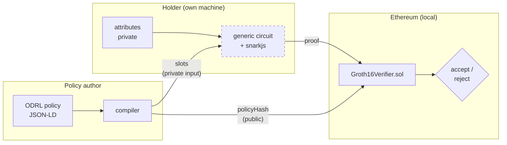

# zk-odrl

Access control where the policy is written in **ODRL** and satisfied through a
**zero-knowledge proof**, verified by a Solidity contract on Ethereum. The
verifier learns that the policy holds and nothing else.

Bachelor's thesis prototype. Code, this README and `docs/how-it-works.md` are
in English; the other documents in `docs/` are in Italian, the language of the
thesis.

## The problem

To prove you may use a resource, conventional access control makes you hand
over the attributes that grant the right: department, role, badge. The check
needs one bit and collects a profile. A zero-knowledge proof separates the two:
the holder proves *"I satisfy this policy"* without revealing the attributes.

The policies are written in [ODRL](https://www.w3.org/TR/odrl-model/), the W3C
standard for rights expression, which describes permissions and prohibitions
over an asset. Satisfying a policy means meeting the constraints of a
permission and matching no prohibition. The thesis asks which parts of ODRL
survive translation into an arithmetic circuit; `docs/odrl-vs-xacml.md`
compares ODRL with XACML.

## How it works

There are three parties: the **policy author** writes the rule, the
**holder** wants the resource, and the **verifier** on chain decides. The
holder answers *"do I satisfy this policy?"* with a proof instead of with
their data.



The dashed box is specified but not built yet (see [Status](#status)).
Today the proof comes from a hello-world circuit with one constraint.

The design rests on two decisions:

- **One circuit for every policy.** The policy is an input of the circuit, not
  compiled into it. Otherwise each rule change needs a new trusted setup and a
  new verifier.
- **The policy reaches the chain as one hash.** Groth16 verification costs
  about 7k gas per public input. The circuit proves that its private policy
  vector hashes to one public `policyHash`, so verification cost does not
  grow with the policy.

The proof hides the holder's attribute values. It does not hide that an
access happened, or when: the request time is a public input, and every
verification lands in a block with a public timestamp.

[`docs/how-it-works.md`](docs/how-it-works.md) explains each building block
(ODRL, compiler, Poseidon, circom, snarkjs, Groth16, verifier, Hardhat) with
diagrams, and shows the printer policy compiled slot by slot.

## Status

| Piece | State |
|---|---|
| ODRL compiler, `policyHash`, reference evaluator, compatibility check | done, tested (`make test`, `check`, `compile`, `evaluate`) |
| Hello-world circuit and verifier: one `gteq` constraint, proved and checked on a local chain | done (`make hello`, `make deny`) |
| Generic circuit that reads the compiler output | specified in `docs/design/design.md` (slots, `policyHash`), not built yet |

The compiler and the hello-world circuit are not connected yet. The
hello-world circuit takes one number and one threshold, not the slots the
compiler produces; the generic circuit will join the two.

## Environment

Every tool version is pinned in `flake.nix` and `flake.lock` (circom 2.2.3,
node 22); the JS dependencies are pinned in `package-lock.json`. Two ways to
get the toolchain:

**Dev container (VS Code).** Needs VS Code with the *Dev Containers*
extension and Docker or Podman.

1. Open the repository folder in VS Code and run *Dev Containers: Reopen in
   Container*.
2. VS Code builds the image from `.devcontainer/Dockerfile`: Debian, nix and
   direnv only, with nix and nixpkgs pinned to the revision of `flake.lock`.
3. On first start `direnv allow .` and `make setup` run: direnv loads
   `flake.nix` in every terminal, and `make setup` installs the JS
   dependencies. The first start downloads the toolchain and takes a few
   minutes; later starts reuse it. The *direnv* and *Nix* VS Code extensions
   are installed automatically.

**nix directly.** With [nix](https://nixos.org/download) and flakes enabled,
`nix develop` opens the same shell; with [direnv](https://direnv.net),
`direnv allow` loads it on entering the folder.

Then install the JS dependencies (done already in the dev container) and
check the toolchain:

```bash
make setup         # npm ci inside the flake toolchain, from any shell
circom --version   # circom compiler 2.2.3
node --version     # v22.23.2
```

`make setup` enters the flake by itself; the other commands below need the
shell to be in it (`nix develop`, direnv or the dev container).

## Run

```bash
make test          # compiler, checker, policyHash and evaluator tests
make check         # is policies/printer.jsonld fully supported? (exit 0 = yes)
make compile       # policies/printer.jsonld -> slots + policyHash
make evaluate      # printer policy, R&D employee, Wednesday 2026-10-14: GRANT
make hello         # hello world: proof for alice, checked off and on chain
make deny          # hello world: bob cannot generate a proof
make clean
```

Three variables change the input. `POLICY` (default `policies/printer.jsonld`)
applies to `check`, `compile` and `evaluate`; `ATTRS` (the user) and `AT` (the
instant) apply to `evaluate`. `evaluate` runs the circuit semantics in plain
JS and generates no proof, so it needs no circuit. The only circuit today is
the hello-world one used by `make hello`.

```bash
make check    POLICY=policies/not-provable.jsonld   # lists duty and count, exit 1
make compile  POLICY=policies/archive.jsonld
make evaluate POLICY=policies/archive.jsonld ATTRS='{"department":"Sales","role":"manager","clearanceLevel":0,"badgeStatus":"active"}'   # manager: GRANT
make evaluate AT=2026-10-17T10:00:00Z                       # Saturday: DENY
make evaluate ATTRS='{"department":"Sales","role":"employee","clearanceLevel":3,"badgeStatus":"active"}'   # Sales: DENY
```

Attribute names are those of `vocab/attributes.json`: `department` (RnD,
Admin, Sales, Operations), `role` (employee, manager, contractor),
`clearanceLevel` (non-negative integer, 0..5 by convention), `badgeStatus`
(active, suspended). The day of the week and the time come from `AT` (UTC).

## What the compiler covers

The compiler accepts one fixed subset (profile) of ODRL 2.2 and rejects
everything else with an error that names the construct. `make check` sorts
a policy's problems into the two kinds below. It lists every construct that
one proof cannot show, and the first construct left out by choice.

**Covered**

- A policy of type `Set` with `uid`, the project `profile` and
  `conflict: prohibit` (a matching prohibition always wins).
- One `permission` and at most one `prohibition`, on the same `target` and
  actions. Several actions give one compiled policy per (target, action).
  `target`, `action` and `assignee` may also be written once at policy level;
  `assigner` is accepted and ignored.
- Attributes: `department`, `role`, `clearanceLevel`, `badgeStatus` (private,
  attested by the issuer); `dayOfWeek` and `dateTime` (from the public time of
  the request).
- Operators `eq`, `neq`, `lt`, `lteq`, `gt`, `gteq`, `isAnyOf`, `isNoneOf`,
  restricted by type: no ordering on enums, only ordering on `dateTime`.
- Constraints of a rule combined by one flat `and`, `or` or `xone`.
- Unsigned integers below 2^64; `dateTime` with an explicit time zone, in
  whole seconds. Up to 4 constraints per rule and 4 values per set.

**Not covered, because one proof cannot show it.** A proof shows that data
satisfy a condition at one instant. It cannot show a future action (`duty`,
`obligation`, `consequence`, `remedy`), an order of events (`andSequence`), or
anything that depends on earlier uses (`count`, `meteredTime`,
`timeInterval`, `elapsedTime`, `delayPeriod`, `event`, `payAmount`, `status`).

**Not covered, by choice.** Provable in principle, left out to keep the
prototype small: other policy types, other `conflict` strategies,
`inheritFrom`, more than one permission or prohibition, nested logical
constraints, `isA` / `isPartOf` / `hasPart` / `isAllOf`, `refinement`,
`rightOperandReference`, `unit`, asset and party collections, every other
`leftOperand` (location, purpose, device, …), strings, decimals and negative
numbers.

## Repository

| Path | What it is for |
|---|---|
| `Makefile` | every command above, `make setup` included; build output goes to `build/` |
| `flake.nix`, `flake.lock` | pinned toolchain (circom, node), loaded by `nix develop` |
| `.envrc` | loads the same toolchain automatically with direnv |
| `.devcontainer/` | VS Code dev container (see Environment): `Dockerfile` and `devcontainer.json` |
| `.github/workflows/ci.yml` | CI on every push: `make setup`, `test`, `check`, `hello`, `deny` in the flake toolchain |
| `package.json`, `package-lock.json` | exact versions of the JS dependencies |
| `hardhat.config.js` | local EVM used to deploy and call the verifier |
| `src/compile.js` | ODRL compiler: checks the profile, produces the slots |
| `src/policy-hash.js` | `policyHash` of a compiled policy (Poseidon) |
| `src/evaluate.js` | reference semantics of the circuit, GRANT or DENY |
| `src/check.js` | compatibility check: compatible, or the list of problems by kind |
| `scripts/check-policy.js` | command line for the check (`make check`) |
| `scripts/compile-policy.js` | command line for the compiler (`make compile`) |
| `scripts/evaluate-policy.js` | command line for the evaluator (`make evaluate`) |
| `scripts/policy-input.js` | hello world: policy + attributes -> circuit input |
| `scripts/hello-onchain.js` | hello world: deploys the verifier, compares snarkjs and contract |
| `circuits/policy.circom` | hello-world circuit: `attribute >= threshold`, 64-bit range check |
| `contracts/Groth16Verifier.sol` | verifier generated by snarkjs, never edited by hand |
| `vocab/attributes.json` | encoding table: attribute codes, resources, the party policies are assigned to |
| `vocab/odrl.jsonld` | local copy of the ODRL context, so compiling needs no network |
| `policies/printer.jsonld` | reference policy: printer for R&D and Admin on weekdays, never with a suspended badge |
| `policies/archive.jsonld` | example of `or` between constraints |
| `policies/not-provable.jsonld` | the printer policy plus a `duty` and a `count`: `make check` lists both |
| `policies/hello/` | hello-world only: `hello.json` (one `gteq` constraint, outside the compiler profile), `alice.json` (level 4, proof) and `bob.json` (level 2, no proof) |
| `test/` | tests run by `make test`; `vectors/printer.json` pins the printer `policyHash` |
| `docs/design/design.md` | encoding spec (Italian): circuit parameters, value width, slot layout, `policyHash` preimage |
| `docs/design/profilo-odrl.md` | ODRL profile (Italian): accepted subset, attribute encoding, decision semantics, coverage table |
| `docs/how-it-works.md` | the building blocks explained, with diagrams |
| `docs/odrl-vs-xacml.md` | pros and cons of ODRL against XACML (Italian) |

## Limits

- The trusted setup uses a public beacon: anyone can forge proofs. Demo only.
- The contract is called with `eth_call` on the in-process Hardhat EVM, no
  transaction. The gas is an estimate for a whole transaction (21000 base
  included).
- The on-chain pipeline supports only one `gteq` constraint; the compiler
  already handles full policies, the circuit for them is the next step.

## License

MIT. `contracts/Groth16Verifier.sol` is generated by snarkjs (GPL-3.0).
