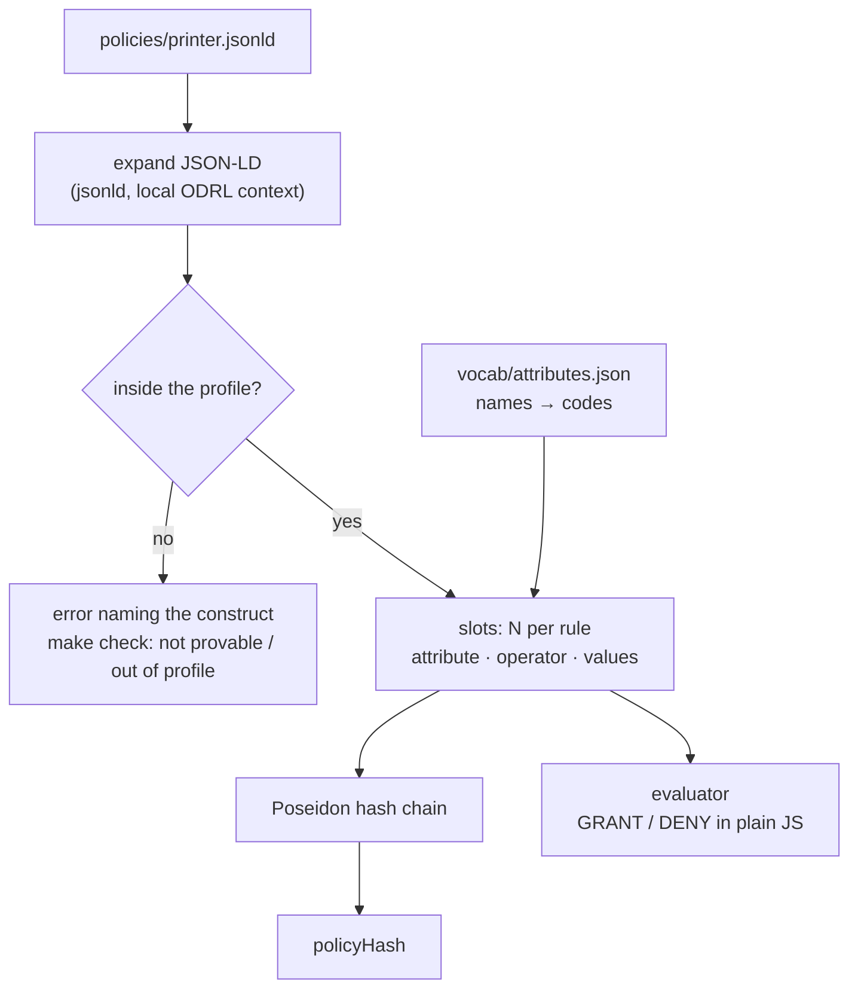
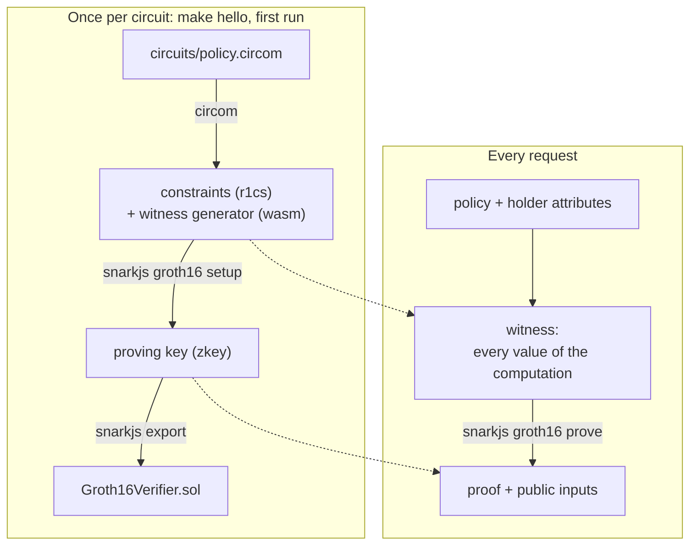
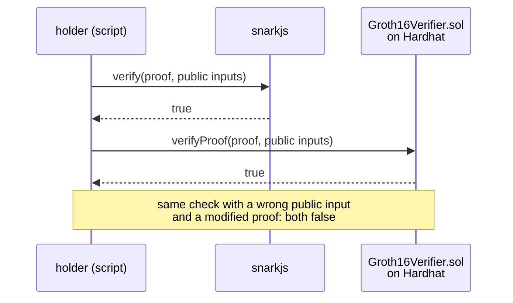

# How zk-odrl works

The overall flow and the current status are in the [README](../README.md).
This page explains each building block: what it is and why the project needs
it.

## What each party knows

| Value | Who knows it | Why |
|---|---|---|
| attribute values (department, role, …) | holder only | private inputs of the circuit; the proof reveals nothing about them |
| slots (operators, thresholds, sets) | holder and author | private inputs too, but bound to the public `policyHash` |
| `policyHash` | everyone | the one number that names the policy on chain |
| request time `now` | everyone | public input, so "weekdays only" can be checked |
| result | everyone | the proof is valid or it is not |

## 1. From ODRL to numbers: the compiler

A circuit only computes with integers, so the policy is turned into a fixed
table of numbers first. This part is plain JavaScript and runs off chain.

| Block | What it does |
|---|---|
| **ODRL** (W3C, JSON-LD) | the language of the rule: *"R&D and Admin may print on weekdays; never with a suspended badge"* |
| **profile** | the ODRL subset this project accepts (see [What the compiler covers](../README.md#what-the-compiler-covers)); it fixes operators and attributes in advance, which is what makes one generic circuit possible |
| **compiler** (`src/compile.js`) | checks the profile and writes each constraint into a *slot*: which attribute, which operator, which values |
| **`vocab/attributes.json`** | turns names into numbers (`RnD` → 1, `suspended` → 2, …); the compiler and whoever attests the attributes read the same table |
| **Poseidon** (`src/policy-hash.js`) | a hash function designed to be cheap inside a ZK circuit, unlike SHA-256; it squeezes every slot into one `policyHash`, computed the same way in JS and in circom |
| **evaluator** (`src/evaluate.js`) | the decision the circuit will take, in plain JS and in clear; it is the test oracle, not part of the access flow |
| **check** (`src/check.js`, `make check`) | says whether a policy fits, and if not, whether the obstacle is ZK itself or only the scope of the prototype |

The printer policy compiled, with N = 4 slots per rule (`make compile`):

| Rule | Slot | Attribute | Operator | Values |
|---|---|---|---|---|
| permission (`and`) | 0 | `department` | `isAnyOf` | RnD, Admin (codes 1, 2) |
| | 1 | `dayOfWeek` | `lt` | 5 (Monday = 0) |
| | 2–3 | – | `noop` | – |
| prohibition (`and`) | 0 | `badgeStatus` | `eq` | suspended (code 2) |
| | 1–3 | – | `noop` | – |

Access is granted when the permission holds and the prohibition does not.

## 2. From numbers to a proof: circom and snarkjs

| Block | What it does |
|---|---|
| **circuit** | the program whose correct execution is proved. Today: `attribute >= threshold`. Next: the generic circuit that reads the slots, evaluates them and recomputes `policyHash` |
| **circom** 2.2.3 | the language of the circuit; compiles it into arithmetic constraints and into a program that computes the witness |
| **circomlib** | standard circom components: comparators, Poseidon, bit decomposition |
| **witness** | all the values that satisfy the constraints. If the policy is not satisfied no witness exists, so there is no proof to send: this is `make deny` |
| **snarkjs** 0.7.6 | runs the cryptography: trusted setup, proof, export of the Solidity verifier |
| **Groth16** | the proof system: the smallest proof and the cheapest on-chain check (about 214k gas here), at the price of one setup per circuit, hence one generic circuit |
| **trusted setup** | creates the keys to prove and to verify. Here it uses a public beacon, so anyone could forge proofs: fine for a demo, not for real use |

## 3. Checking the proof: Solidity and Hardhat

| Block | What it does |
|---|---|
| **Solidity** | the language of Ethereum contracts |
| **`Groth16Verifier.sol`** | generated by snarkjs from the verification key, never edited by hand; answers only "is this proof valid for these public inputs?" |
| **Hardhat** 3 | an Ethereum node running on your machine: compiles, deploys and calls the contract, no testnet and no real money |
| **viem** | the JS library the scripts use to talk to the contract |

## 4. Same environment for everyone: nix

`flake.nix` and `flake.lock` pin circom, node and every tool to exact
versions; `package-lock.json` pins the JS libraries. The dev container, `nix
develop` and the CI all load the same toolchain, so results are reproducible.
